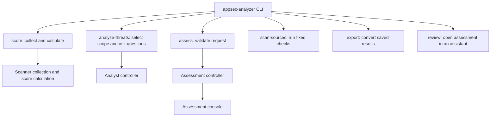

# Architecture

AppSec Analyzer is a Python command-line application. Its analysis engine was extracted from AppSec Advisor. This guide explains which modules own each workflow and how they may depend on one another. For usage, see the [README](README.md) and [user guides](docs/README.md). Detailed execution and data rules live in the [technical contracts](docs/internal/contracts/).

## Application and engine

The public command is `appsec-analyzer`. [cli.py](appsec_analyzer/cli.py) parses its arguments; [__main__.py](appsec_analyzer/__main__.py) starts the same command through `python -m appsec_analyzer`.

The `appsec_analyzer/` package owns command handling, scoring, focused analysis, assessment requests, terminal output, and shared services. The engine under `scripts/` runs assessments, admits source files, manages state and model calls, validates results, and creates reports. The [script layout](scripts/README.md) describes its modules.

The main workflows are:

The diagram shows who owns each workflow, rather than every import. `scan-sources` and `score` make no model calls. `assess` runs the model-backed assessment pipeline. Focused analysis uses a separate controller and job state.

## Workflow ownership

Keep workflow coordination, calculation, and presentation separate. Reusable modules must work without importing the public command parser.

| Area | Responsibility |
| --- | --- |
| Score workflow | [score/service.py](appsec_analyzer/score/service.py) checks source admission, runs collection, checks evidence, and validates the result. |
| Score collection | [score/collection.py](appsec_analyzer/score/collection.py) selects scanners, runs them, and collects their results. |
| Score calculation | [score/calculation.py](appsec_analyzer/score/calculation.py) calculates scores from rules, findings, and a `ScoringPolicy`. Pass a loaded policy to calculate without file access or process execution. |
| Score presentation | [score/render.py](appsec_analyzer/score/render.py) formats results. [score/progress.py](appsec_analyzer/score/progress.py) displays `ScoreEvent` progress and adapts older text callbacks. |
| Focused analysis | [analyze_threats/cli.py](appsec_analyzer/analyze_threats/cli.py) handles terminal interaction. [preparation.py](appsec_analyzer/analyze_threats/preparation.py) selects scope and prepares project documents. |
| Analyst jobs | [analyst_controller.py](scripts/orchestrator/analyst_controller.py) owns job state and the `waiting_job`, `run`, `answer`, and `cancel` interfaces. The terminal reads pending questions through this interface, not checkpoint files. Analyst state has its own directory. |
| Host assessment preparation | [assessment_entry.py](appsec_analyzer/assessment_entry.py) provides launch, dialogue, active-run tracking, and stale-state cleanup to installed hosts. Hosts do not need to parse private state. |
| Assessment requests | [assessment/request.py](appsec_analyzer/assessment/request.py) passes validated CLI options to the controller as an `AssessmentRequest`. It preserves original configuration arguments and argument-list support for direct script callers. |
| Assessment execution | [orchestration_controller.py](scripts/orchestrator/orchestration_controller.py) runs the pipeline. [assessment/console.py](appsec_analyzer/assessment/console.py) displays progress. |
| Platform security settings | [platform_settings/](appsec_analyzer/platform_settings/) reads GitHub and GitLab settings. `service.py` runs checks, `phase.py` stores results, and `projection.py` prepares fixed-value summaries for models and reports. This phase runs after context capture and before architecture analysis. |
| Organization distributions | [distribution.py](appsec_analyzer/distribution.py) creates an organization distribution from the packaged example and sets its engine versions. It reads and writes only the named directory. [organization.py](appsec_analyzer/organization.py) loads installed distributions at runtime. |
| Saved-result export | [exports.py](appsec_analyzer/exports.py) checks completed state and file hashes, runs converters with time limits, and writes only to a new private directory. [export_assets.py](appsec_analyzer/export_assets.py) restricts document resources and rejects active markup before embedding. Export creates no model host. |
| Assessment review | [review.py](appsec_analyzer/review.py) starts an interactive assistant with the bundled review skill and saved report paths. [review_context.py](appsec_analyzer/review_context.py) provides validated, read-only queries through the engine facts builder. The assistant uses its own dialogue, permissions, account, and usage; it does not resume an Analyzer model job. |
| Copilot CLI connection | [copilot_cli.py](appsec_analyzer/copilot_cli.py) runs exchanges in private temporary directories with tools disabled and execution limits. It validates JSON before the controller accepts a result. |

### Survey and verification

The survey analyzes threats per component using STRIDE. Verification checks selected security aspects after the survey and before findings are merged.

| Part | Responsibility |
| --- | --- |
| Verification catalog | [data/test-cases.yaml](data/test-cases.yaml) defines the checks. [schemas/test-cases.schema.yaml](schemas/test-cases.schema.yaml) validates the catalog. |
| Depth settings | [data/assessment-depths.yaml](data/assessment-depths.yaml) defines the work at each depth. [depth_settings.py](appsec_analyzer/depth_settings.py) applies organization and team defaults. [profiles.py](appsec_analyzer/profiles.py) resolves scan-profile values and `test_cases`; the configuration resolver then applies the organization's settings. The controller adds the organization's required aspects. |
| Results and finding links | [case_outcomes.py](scripts/model/case_outcomes.py) links scanner findings to verification items and derives `rules` outcomes from scanner results. It groups a verification finding under a survey finding when their CWE and location match. A verified control at that location marks the survey finding as contradicted. |
| Model input and validation | [case_candidates.py](scripts/model/case_candidates.py) prepares starting candidates and shares them across jobs. [case_postchecks.py](scripts/model/case_postchecks.py) holds fixed post-checks. [case_analysis.py](scripts/contexts/case_analysis.py) validates replies from `test_case_investigator` and `open_reviewer`. |
| Verification jobs | [assessment_test_cases.py](scripts/orchestrator/assessment_test_cases.py) runs the selected aspects, reports budget coverage before the first job, and saves component results, findings, and incomplete aspects in the working directory. |
| Open review | `AssessmentBudget.hold` in [assessment_jobs.py](scripts/runtime/assessment_jobs.py) reserves its budget. The open review does not run yet. |
| Report and export | The composer renders the appendix, verification findings, and finding links. The SARIF exporter names linked findings by verification item. |

## Shared services and dependency direction

Command handlers call application workflows. Workflows use shared services and engine modules. Shared services must not import the public CLI or an application controller.

Workflows share the code that executes scanners. Each workflow still decides which scanners to run, their order, when they apply, and how to handle partial results.

| Shared service | Module |
| --- | --- |
| Size-limited artifact reads and writing new output files | [artifacts.py](appsec_analyzer/artifacts.py) |
| Validating completed assessments for export and review | [saved_assessment.py](appsec_analyzer/saved_assessment.py) |
| Requirements catalog checks | [catalogs.py](appsec_analyzer/catalogs.py) |
| Safe terminal fields and export targets | [terminal.py](appsec_analyzer/terminal.py), [targets.py](appsec_analyzer/targets.py) |
| Scanner execution and result validation | [scanners/execution.py](appsec_analyzer/scanners/execution.py) |
| Codex structured output | [codex_schema.py](appsec_analyzer/codex_schema.py) converts analysis contracts to CLI output schemas and decodes JSON. The controller still validates the canonical result and authorizes actions. |
| Repository checks before analysis | [runtime/source_preflight.py](scripts/runtime/source_preflight.py) |
| Finding infrastructure configuration | [analyzers/iac_surface.py](scripts/analyzers/iac_surface.py) |

Runtime and controller code enforce source access, model permissions, budgets, and output publication. Agent Markdown, repository text, and model replies are inputs; they cannot grant permission to execute actions. See [SECURITY.md](SECURITY.md), the [orchestration contract](docs/internal/contracts/orchestration-actions.md), and the [context-routing contract](docs/internal/contracts/context-routing.md).

Active architecture and STRIDE jobs use [architecture-analysis-policy.md](data/architecture-analysis-policy.md) and [stride-analysis-policy.md](data/stride-analysis-policy.md), selected by [model_roles.py](appsec_analyzer/model_roles.py). Architecture receives finalized components and returns flows, external entities, and assets. Its policy does not allow discovery, shell tools, file writes, or publication. The model host reserves correction exchanges within each job's fixed limit. Retained agent files describe earlier procedures and must not replace these active policies.

## Compatibility and migration limits

[engine.py](appsec_analyzer/engine.py) locates engine modules in checkouts and installed wheels without importing the CLI. The engine stays under `scripts/` and uses imports such as `runtime`, `model`, and `orchestrator`.

[scoring.py](appsec_analyzer/scoring.py), [score_progress.py](appsec_analyzer/score_progress.py), and [threat_analysis.py](appsec_analyzer/threat_analysis.py) preserve older Python interfaces. The retained [security_score.py](scripts/analyzers/security_score.py) script still supports its direct command and original output. An old name alone is no reason to delete a module.

Runtime fingerprints include application Python files and engine resources. An implementation change prevents resume with incompatible earlier state. Moving engine code requires checking imports, file and subprocess dispatch, resource lookup, prompts, packaging, and tests together.

The [module-boundary change record](specs/changes/application-module-boundaries/proposal.md) explains the earlier refactoring and its compatibility decisions.

## Verification and maintenance

[test_module_boundaries.py](tests/test_module_boundaries.py) checks independent workflow imports, calculation with a loaded policy, structured progress, assessment options, analyst job isolation, and runtime identity. [test_analyzer_distribution.py](tests/test_analyzer_distribution.py) checks packaging. These tests do not qualify the whole distribution or live model connections. Choose further tests using the [requirement bindings](data/requirement-bindings.yaml) and [contributor guide](CONTRIBUTING.md).

Update this guide when module ownership, dependencies, or compatibility adapters change. Keep detailed execution rules in the contracts, engine-module descriptions in the script layout, and user outcomes in [requirements.md](requirements.md).
