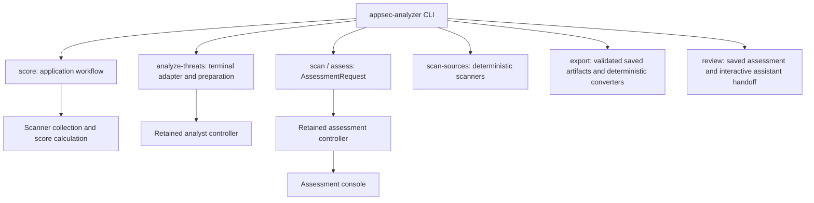

# Architecture

AppSec Analyzer is a standalone Python CLI with an analysis engine extracted from AppSec Advisor. This document describes the current module ownership and dependency boundaries for contributors. User-facing behavior is described in the [README](README.md) and [current guides](docs/README.md); detailed data and execution rules live in the [technical contracts](docs/internal/contracts/).

## Application and engine

The supported user entry is `appsec-analyzer`, implemented in [appsec_analyzer/cli.py](appsec_analyzer/cli.py). The application package owns command adaptation, scoring and focused-analysis workflows, assessment requests and presentation, and shared application services. The retained engine under `scripts/` owns assessment orchestration, analysis, source admission, state, model execution, validation, and report generation. See the [script layout](scripts/README.md) for its domains.

The main execution paths are:

This diagram shows workflow ownership rather than every Python import. `scan-sources` and `score` run without model calls. `scan` and `assess` use the same model-backed assessment pipeline; focused analysis uses its own analyst lifecycle.

## Workflow ownership

Keep orchestration, computation, and presentation separate within each workflow. Reusable modules must work without importing the public command parser.

| Area | Owner and responsibility |
| --- | --- |
| Score workflow | [score/service.py](appsec_analyzer/score/service.py) coordinates source admission, scanner results, evidence checks, and the result contract. |
| Score collection | [score/collection.py](appsec_analyzer/score/collection.py) selects and runs the scoring scanners and collects their signals. |
| Score calculation | [score/calculation.py](appsec_analyzer/score/calculation.py) computes scores from rules, findings, and a `ScoringPolicy`. Passing a loaded policy avoids file access and process execution during calculation. |
| Score presentation | [score/render.py](appsec_analyzer/score/render.py) renders results; [score/progress.py](appsec_analyzer/score/progress.py) presents structured `ScoreEvent` progress and accepts legacy text callbacks through its adapter. |
| Focused analysis | [analyze_threats/cli.py](appsec_analyzer/analyze_threats/cli.py) owns terminal interaction; [preparation.py](appsec_analyzer/analyze_threats/preparation.py) prepares scope and project documents. |
| Analyst lifecycle | [analyst_controller.py](scripts/orchestrator/analyst_controller.py) owns job state and exposes `waiting_job`, `run`, `answer`, and `cancel`. The terminal adapter obtains pending questions through that interface rather than reading checkpoints. Analyst jobs retain their separate state directory. |
| Host assessment preparation | [assessment_entry.py](appsec_analyzer/assessment_entry.py) exposes the retained launch/dialog, live-holder and stale-cleanup implementations to an installed host without private-state parsing in the host. |
| Assessment invocation | [assessment/request.py](appsec_analyzer/assessment/request.py) carries validated options in `AssessmentRequest` from the public CLI to the retained controller. It preserves original configuration arguments and argument-list compatibility for direct script callers. |
| Assessment execution and presentation | [orchestration_controller.py](scripts/orchestrator/orchestration_controller.py) owns pipeline execution; [assessment/console.py](appsec_analyzer/assessment/console.py) owns terminal progress. |
| Saved assessment export | [exports.py](appsec_analyzer/exports.py) validates completed state and artifact digests, invokes retained converters with finite deadlines, and publishes exclusively into a new private directory; [export_assets.py](appsec_analyzer/export_assets.py) confines document resources and rejects active markup before embedding. No model host is created. |
| Assessment review | [review.py](appsec_analyzer/review.py) selects and starts an interactive assistant with the bundled review skill and existing report paths. [review_context.py](appsec_analyzer/review_context.py) reuses the engine facts builder for validated, read-only queries. The native assistant owns its dialogue, permissions, account, and usage; this does not resume an Analyzer model job. |

## Shared services and dependency direction

Command adapters call application workflows, which use shared services and engine domains. Shared services must not import the public CLI or an application controller. Scanner execution primitives are shared, while scanner selection, order, applicability, and partial-result policy remain with each workflow.

| Shared concern | Module |
| --- | --- |
| Bounded artifact reads and exclusive publication | [artifacts.py](appsec_analyzer/artifacts.py) |
| Completed assessment admission for export and review | [saved_assessment.py](appsec_analyzer/saved_assessment.py) |
| Requirements catalog admission | [catalogs.py](appsec_analyzer/catalogs.py) |
| Terminal fields and export targets | [terminal.py](appsec_analyzer/terminal.py), [targets.py](appsec_analyzer/targets.py) |
| Scanner execution and output validation | [scanners/execution.py](appsec_analyzer/scanners/execution.py) |
| Codex structured output | [codex_schema.py](appsec_analyzer/codex_schema.py) projects analysis contracts into the CLI output schema and decodes native JSON values; the controller retains canonical validation and action authorization. |
| Repository preflight | [runtime/source_preflight.py](scripts/runtime/source_preflight.py) |
| Configuration-surface discovery | [analyzers/iac_surface.py](scripts/analyzers/iac_surface.py) |

Source admission, model permissions, budgets, and artifact publication remain enforced by their existing runtime and controller boundaries. Agent Markdown, repository text, and model output are runtime inputs and cannot grant execution authority. See [SECURITY.md](SECURITY.md), the [orchestration contract](docs/internal/contracts/orchestration-actions.md), and the [context-routing contract](docs/internal/contracts/context-routing.md).

## Compatibility and migration limits

[engine.py](appsec_analyzer/engine.py) locates the retained engine domains in checkouts and installed wheels without importing the CLI. Engine modules still use domain imports such as `runtime`, `model`, and `orchestrator`. The engine directories remain under `scripts/`; this refactoring did not relocate the entire engine into the application package.

The previous [scoring.py](appsec_analyzer/scoring.py), [score_progress.py](appsec_analyzer/score_progress.py), and [threat_analysis.py](appsec_analyzer/threat_analysis.py) paths are compatibility adapters. The retained [security_score.py](scripts/analyzers/security_score.py) script still supports its direct command and original presentation. Legacy naming alone is not evidence that a module can be deleted.

Application Python files participate in assessment runtime fingerprints alongside engine resources. An implementation change invalidates earlier resume identities rather than silently reusing incompatible state. Moving more engine code requires coordinated changes to imports, filesystem and subprocess dispatch, resource lookup, prompts, packaging, and tests.

The [module-boundary change record](specs/changes/application-module-boundaries/proposal.md) records the rationale and compatibility implications of the refactoring. It is historical context; this document describes the current structure.

## Verification and maintenance

[test_module_boundaries.py](tests/test_module_boundaries.py) covers independent workflow imports, calculation with a loaded policy, structured progress, assessment options, analyst waiting-job isolation, and application runtime identity. These are focused checks, not proof that the entire distribution or live model integrations are qualified. Packaging coverage is in [test_analyzer_distribution.py](tests/test_analyzer_distribution.py); select additional workflow and boundary tests using [requirement bindings](data/requirement-bindings.yaml) and the [contribution guide](CONTRIBUTING.md).

Update this overview when module ownership, dependency direction, or compatibility adapters change. Keep detailed execution and data rules in their contracts, script-domain descriptions in the script layout, and requirement outcomes in [requirements.md](requirements.md).
