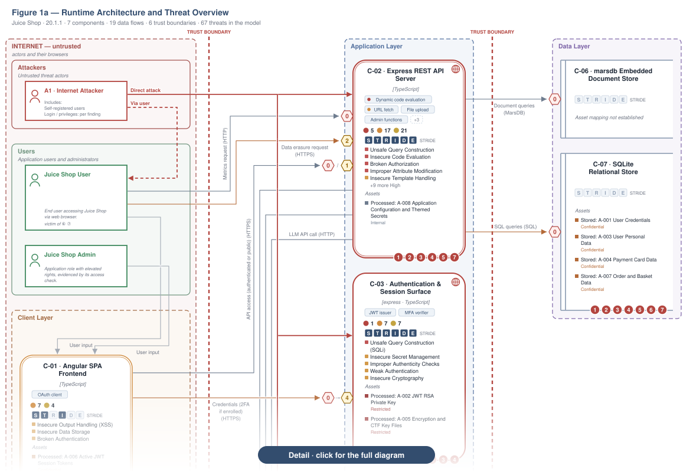
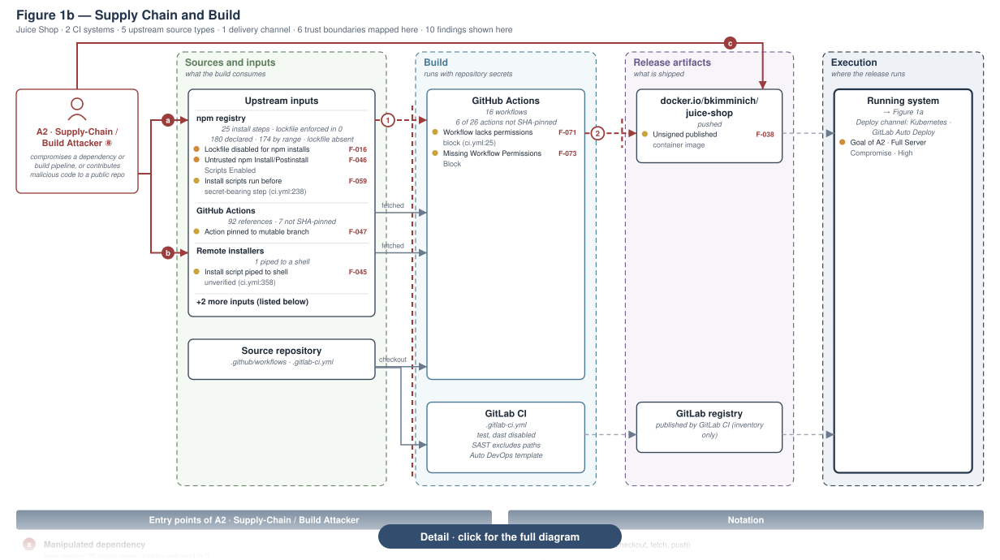

# appsec-analyzer

[](engine.json)
[](setup.py)
[](LICENSE)
[](docs/model-selection.md)
[](docs/security-assessment.md)
[](https://docs.oasis-open.org/sarif/sarif/v2.1.0/sarif-v2.1.0.html)

> [!NOTE]
> **Alpha.** Commands and report formats may change. Live assessment quality is still being qualified; review findings before acting on them.

AppSec Analyzer reviews application security from source code. It maps components, data flows, and trust boundaries, checks the security controls it finds, and reports findings with code references and suggested fixes. It works on one Git repository or on several repositories that form one system.

It does not perform SCA/CVE scanning, comprehensive secret scanning, or runtime testing. Deployment controls and business assumptions still need your own review.

[Quick start](#quick-start) · [Modes](#modes) · [Workflow](#workflow) · [Data use](#security-and-data-use) · [Install](#install) · [Options](#options) · [Reports](#reports-and-exports) · [Documentation](#documentation)

## Quick start

You need Python 3.10+, Git, and [pipx](https://pipx.pypa.io/stable/). Replace `/path/to/project` with the repository you want to examine.

1. Install the preview from GitHub:

   ```sh
   pipx install "git+https://github.com/appsec-foundry/appsec-analyzer.git"
   ```

2. Get a quick score. This makes no model calls and costs nothing:

   ```sh
   appsec-analyzer score /path/to/project
   ```

3. Run a full assessment. This needs a [model provider](#model-provider) and makes paid model calls with a default limit of **USD 20**:

   ```sh
   appsec-analyzer scan --repo /path/to/project --output /path/to/assessment
   ```

   `/path/to/assessment` is a new directory outside the analyzed repository. Without `--output`, results go to your user's `appsec-analyzer/assessments` data directory.

4. Discuss the findings and plan fixes in Claude Code or Codex:

   ```sh
   appsec-analyzer review /path/to/assessment
   ```

## Modes

Every mode is a subcommand of `appsec-analyzer`; add `--help` to see its options. `score`, `scan-sources`, and `export` work without model calls. All other modes send source excerpts to a model provider and stop at a spending limit; see [Security and data use](#security-and-data-use) and [Options](#options).

| Mode | Purpose |
| --- | --- |
| [`scan`](#scan-full-security-assessment) | Full security assessment of a repository or a system of repositories. |
| [`analyze-threats`](#analyze-threats-answer-a-security-question) | Answer one security question about the code, a planned design, or a change. |
| [`authnz-review`](#authnz-review-authentication-and-authorization-review) | Review authentication and authorization only. |
| [`audit-requirements`](#audit-requirements-requirements-audit) | Check a repository against a security requirements catalog. |
| [`score`](#score-deterministic-security-rating) | Quick security rating from 0 to 100. |
| [`scan-sources`](#scan-sources-raw-scanner-observations) | Raw scanner observations without a rating. |
| [`review`](#review-discuss-an-assessment-with-ai) | Discuss a finished assessment and plan fixes with an AI coding assistant. |
| [`export`](#export-other-report-formats) | Convert a finished assessment to SARIF, HTML, PDF, and other formats. |

### `scan`: full security assessment

`scan` maps components, data flows, and trust boundaries, checks the security controls it finds, and reports findings with code references and suggested fixes. It uses model calls. See [Security assessment](docs/security-assessment.md).

```sh
# Assess one repository
appsec-analyzer scan --repo /path/to/project

# Assess a backend and its web frontend together as one system
appsec-analyzer scan --repo /path/to/backend --repo /path/to/frontend
```

`assess` runs the same assessment without defaults: it requires `--repo` and an explicit `--profile`. Use it in scripts and CI. See [Hosts and models](docs/model-selection.md).

```sh
# Run in CI with a fixed provider profile and without questions
appsec-analyzer assess --repo /path/to/project --profile claude --non-interactive
```

### `analyze-threats`: answer a security question

`analyze-threats` answers one security question about the current code, a planned design, or a selected change. It needs no prior assessment and uses model calls. See [Threat Analyst](docs/threat-analyst.md).

```sh
# Ask about the current code
appsec-analyzer analyze-threats "Can a normal user read another customer's orders?"

# Check your staged changes before you commit them
appsec-analyzer analyze-threats "Does this change weaken access control?" --staged

# Discuss a planned feature before it is built
appsec-analyzer analyze-threats "How should we protect the new CSV export?" --design
```

### `authnz-review`: authentication and authorization review

`authnz-review` checks the routes, authentication checks, and authorization patterns of one repository. It needs no prior assessment and uses model calls. See [AuthNZ review](docs/authnz-review.md).

```sh
# Review login and permission checks
appsec-analyzer authnz-review --repo /path/to/project

# Save the report and fail a CI job on Critical or High findings
appsec-analyzer authnz-review --repo /path/to/project --save --gate
```

### `audit-requirements`: requirements audit

`audit-requirements` checks whether a repository implements each requirement of a local YAML catalog. It uses model calls through Claude CLI. The output directory must already exist. See [Requirements audit](docs/security-requirements-audit-skill.md).

```sh
# Try the audit with the bundled sample catalog
mkdir /path/to/audit
appsec-analyzer audit-requirements --repo /path/to/project --demo --output /path/to/audit --host claude-cli

# Check your own catalog and write a Markdown report
appsec-analyzer audit-requirements --repo /path/to/project \
  --requirements /path/to/catalog.yaml --output /path/to/audit --host claude-cli --md
```

### `score`: deterministic security rating

`score` rates a local checkout or Git URL from 0 to 100 and lists findings, coverage, and limits. It makes no model calls. It reports `undetermined` when coverage is too low. It sees only what its rules cover and does not replace `scan`. See [Security score](docs/security-score.md).

```sh
# Rate a local checkout
appsec-analyzer score /path/to/project

# Rate a remote repository and print JSON for scripts
appsec-analyzer score https://github.com/your-org/your-project.git --json
```

### `scan-sources`: raw scanner observations

`scan-sources` lists unverified observations from the authorization, mass-assignment, and configuration scanners, with their coverage. It makes no model calls and does not replace `scan`.

```sh
# Show what the scanners found, without a rating
appsec-analyzer scan-sources --repo /path/to/project
```

### `review`: discuss an assessment with AI

`review` opens a finished assessment in Claude Code or Codex so you can discuss findings and plan fixes. The assistant starts in read-only mode and uses its own account, not the scan budget. `--preview` shows the handoff without model calls. See [Review guide](docs/security-assessment.md#review-an-assessment-with-ai).

```sh
# Discuss the findings with the assistant recorded in the assessment
appsec-analyzer review /path/to/assessment

# Use Codex instead
appsec-analyzer review /path/to/assessment --with codex
```

### `export`: other report formats

`export` writes a finished assessment to other formats without model calls. The destination must be a new directory. See [Reports and exports](#reports-and-exports).

```sh
# Create SARIF for code scanning and HTML for reading
appsec-analyzer export --assessment /path/to/assessment --output /path/to/export --formats sarif html
```

### Helper commands

| Command | Purpose |
| --- | --- |
| `preflight` | Checks repository access and provider setup before you spend budget. |
| `status`, `progress`, `results`, `stop` | Follow, inspect, or stop a running assessment. |
| `profiles` | Lists and validates scan and model profiles. |
| `capabilities` | Shows the available scanners and provider qualification. |

## Workflow

This example takes one repository from a free first check to a reviewed assessment. It uses a fixed output directory so that every later command can find the same assessment.

```sh
# 1. Free first check: no model calls, no cost.
appsec-analyzer score /path/to/project

# 2. Check repository access and provider setup. No assessment starts yet.
appsec-analyzer preflight --repo /path/to/project

# 3. Run the full assessment into a private directory outside the repository.
mkdir -m 700 /path/to/assessment
appsec-analyzer scan --repo /path/to/project --output /path/to/assessment

# 4. From a second terminal: follow or stop the running assessment.
appsec-analyzer progress --output /path/to/assessment

# 5. Discuss the finished assessment with an AI coding assistant.
appsec-analyzer review /path/to/assessment
```

Notes on the steps:

1. `score` shows whether a full assessment is worth its cost. `scan-sources` lists the underlying scanner observations instead of a score.
2. `preflight` is optional. `scan` runs the same checks before it starts; see [preflight checks](docs/security-assessment.md#preflight-checks).
3. `scan` stops spending at USD 20 by default; `--budget 10` sets a different limit. The limit is a maximum, not an estimate. When it runs out, the run keeps its progress and reports the assessment as incomplete. If you omit `--output`, results go to a private directory under your user's `appsec-analyzer/assessments` data directory. An explicit `--output` must be a private directory outside every analyzed repository.
4. `status` and `stop` take the same `--output` option. To continue an interrupted or paused run, repeat the `scan` command from step 3 and add `--resume`.
5. `review` starts Claude Code or Codex in read-only mode. It uses the assistant's own account, not the scan budget. `--with` selects the assistant, and `--preview` shows the handoff without model calls.

To get SARIF, HTML, PDF, or other formats later, use `export`; see [Reports and exports](#reports-and-exports). For unattended runs and recovery, see [command-line operation](docs/headless-mode.md).

## Security and data use

> [!IMPORTANT]
> **Model-backed commands send source excerpts and context to the selected provider.** Check your organization's rules and the provider's data-handling terms before you analyze confidential code.

`score` and `scan-sources` send no source to a model. They still need network access when you pass a Git URL.

Analyzed repositories are untrusted input: their content cannot authorize tools or select provider credentials. Keep credentials out of repository files and Git URLs, and treat reports and intermediate files as sensitive. See the [security policy](SECURITY.md).

## Install

pipx creates its own virtual environment and puts `appsec-analyzer` on your `PATH`. The install command only works if the repository is reachable for your GitHub account. The package is not yet on PyPI.

<details>
<summary>Install with pip or from a local checkout</summary>

With `pip`, inside an activated virtual environment:

```sh
python -m pip install "git+https://github.com/appsec-foundry/appsec-analyzer.git"
```

From a local checkout, for example to install local changes:

```sh
git clone https://github.com/appsec-foundry/appsec-analyzer.git
cd appsec-analyzer
python3 -m venv .venv
. .venv/bin/activate
python -m pip install .
appsec-analyzer version
```

`pipx install .` from the checkout works as well. [Local release preparation](docs/local-release-preparation.md) explains how to build a wheel.

</details>

<details>
<summary>Run from a checkout without installing</summary>

`python3` needs the runtime dependencies from [setup.py](setup.py): `PyYAML>=6,<7`, `jsonschema>=4.20,<5`, and `Jinja2>=3.1,<4`.

```sh
cd /path/to/appsec-analyzer
python3 -m appsec_analyzer.cli scan-sources --repo /path/to/project
```

Replace `appsec-analyzer` with `python3 -m appsec_analyzer.cli` in all examples and always pass `--repo`, because it defaults to the current directory.

</details>

### Model provider

`score` and `scan-sources` need no provider. `scan` and `assess` select their provider with `--profile`; without it, `scan` uses `claude`. `analyze-threats`, `authnz-review`, and `audit-requirements` always use the Claude CLI.

| `--profile` | Provider | Requirement |
| --- | --- | --- |
| `claude` (default) | Claude CLI | `claude` on your `PATH` with a working login or externally configured Anthropic API credentials. |
| `codex` (experimental) | OpenAI API | `OPENAI_API_KEY`. |
| `codex-cli` (experimental) | Codex CLI with your ChatGPT plan | Codex CLI 0.163.0, signed in with `codex login`. See [Codex CLI setup and limits](docs/profiles.md#use-your-chatgpt-plan-with-codex-cli). |
| `lite` (experimental) | LiteLLM gateway | `LITELLM_API_KEY` and a gateway entry in `providers.yaml` with verified prices. See [LiteLLM setup](docs/providers.md#use-litellm). |
| `bedrock` (experimental) | Amazon Bedrock Converse API | `AWS_BEARER_TOKEN_BEDROCK` and a Bedrock entry in `providers.yaml` with verified prices. See [Bedrock setup](docs/providers.md#use-amazon-bedrock). |

The experimental profiles have not completed live assessment qualification. Run `appsec-analyzer profiles list` to see all built-in and user profiles, and `preflight` with the same `--profile` to check the setup without model calls:

```sh
appsec-analyzer preflight --repo /path/to/project --profile codex
```

Examples for each provider:

```sh
# Claude CLI (default)
appsec-analyzer scan --repo /path/to/project

# OpenAI API
appsec-analyzer scan --repo /path/to/project --profile codex

# Codex CLI with a ChatGPT plan: counts model exchanges instead of USD
codex login
appsec-analyzer scan --repo /path/to/project --profile codex-cli --max-calls 1000

# LiteLLM gateway: "claude" names the model entry in providers.yaml
appsec-analyzer scan --repo /path/to/project --profile "lite claude" --budget 20

# Amazon Bedrock
appsec-analyzer scan --repo /path/to/project --profile bedrock --budget 20
```

`codex-cli` rejects USD budget options; limit it with `--max-calls` and optionally `--max-duration SECONDS`. All other profiles use the USD budget from `--budget`.

[Configuration](docs/configuration.md) describes provider setup in detail. Organizations can ship preconfigured profiles; see the [organization packaging guide](docs/organization-distributions.md).

## Options

Command-line options override the defaults from a scan profile.

| Option | Effect |
| --- | --- |
| `--profile NAME` | Model profile. Default: `claude`. |
| `--budget USD` | Maximum spend for `claude`, `codex`, LiteLLM, and Bedrock. Default: 20. `--hard-budget` is an alias. |
| `--assessment-depth LEVEL` | `standard` (default, includes business-logic analysis) or `thorough`, which can cost more without producing more verified results. See [choosing standard or thorough](docs/model-selection.md#choosing-standard-or-thorough). |
| `--repo PATH_OR_URL` | Repeat to assess several repositories as one system. |
| `--abuse-case-file PATH` | Check your own business rules from a YAML file. See [custom abuse cases](docs/security-assessment.md#custom-abuse-cases). |
| `--max-parallel N` | Components analyzed at once, 1 to 16. Default: 2. |
| `--non-interactive` | For CI. Without it, an interactive terminal may ask for a higher budget before skipping work. |
| `--verbose` | Show job and call identities and detailed correction messages. |

[Scan and model profiles](docs/profiles.md) explains how to store settings and choose models per role.

If a provider rate-limits the run or the connection stays down, Analyzer retries and then pauses with exit code 3. Accepted work is kept; rerun the same command with `--resume` later.

## Reports and exports

Each assessment writes `security-assessment.md` for reading and `security-assessment.yaml` for further processing. The report includes diagrams of the analyzed system. These examples come from an assessment of OWASP Juice Shop.

The runtime architecture with its data flows and attack paths, shown as a detail. Click the image to open the full diagram:

<a href="docs/images/figure1-example.svg">
<picture>
  <source media="(prefers-color-scheme: dark)" srcset="docs/images/figure1-example-crop-dark.svg">
  
</picture>
</a>

The build pipeline and the most severe supply-chain attacks on it, shown as a detail. Click the image to open the full diagram:

<a href="docs/images/figure1b-example.svg">
<picture>
  <source media="(prefers-color-scheme: dark)" srcset="docs/images/figure1b-example-crop-dark.svg">
  
</picture>
</a>

Request more formats when you start the scan, for example `scan --repo /path/to/project --sarif --html`:

| Flag | Output |
| --- | --- |
| `--sarif` | SARIF 2.1.0 findings for code-scanning tools. |
| `--html` | HTML report. Requires Pandoc. |
| `--pdf` | PDF report. Requires Pandoc and WeasyPrint; diagrams may also need Mermaid CLI and Chrome. |
| `--threatdragon` | OWASP Threat Dragon model. |
| `--pentest-tasks` | Tasks for follow-up penetration testing. |

To export a completed assessment later, without model calls:

```sh
appsec-analyzer export --assessment /path/to/assessment \
  --output /path/to/new-export --formats markdown yaml sarif html
```

The export directory must be new and outside any Git checkout. See [export prerequisites and limits](docs/security-assessment.md#exports-and-compatibility).

## Documentation

- [Security assessment](docs/security-assessment.md): scope, depth, output, and recovery.
- [Scan and model profiles](docs/profiles.md): defaults, user files, and per-role model selection.
- [Configuration](docs/configuration.md) and [organization profiles](docs/org-profiles.md): settings for local and team use.
- [Hosts, models, and cost](docs/model-selection.md): provider support and spending limits.
- [Command-line operation](docs/headless-mode.md): unattended runs and lifecycle commands.
- [Engine-only composition configuration](docs/organization-distributions.md#engine-only-configuration-for-a-composed-plugin): model-free validation and a configured deterministic score for composed plugins.
- [Documentation index](docs/README.md): all current guides and maintainer references.

## Contributing

See [CONTRIBUTING.md](CONTRIBUTING.md) for development setup and tests, and [product requirements](requirements.md) for intended behavior. Read [AGENTS.md](AGENTS.md) before changing runtime behavior or report contracts.

AppSec Analyzer grew out of [AppSec Advisor](https://github.com/appsec-foundry/appsec-advisor) and is distributed under the [Apache 2.0 license](LICENSE).
